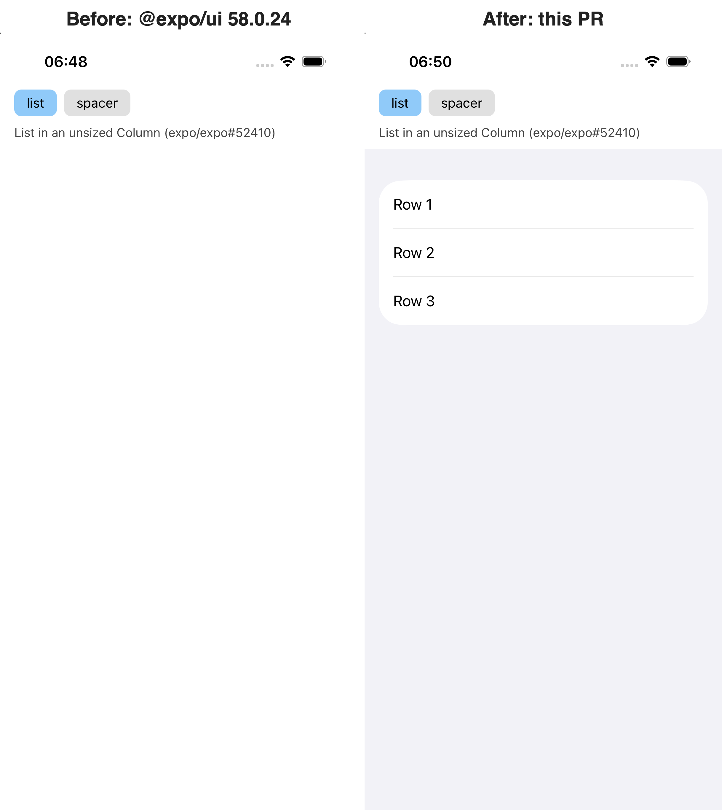
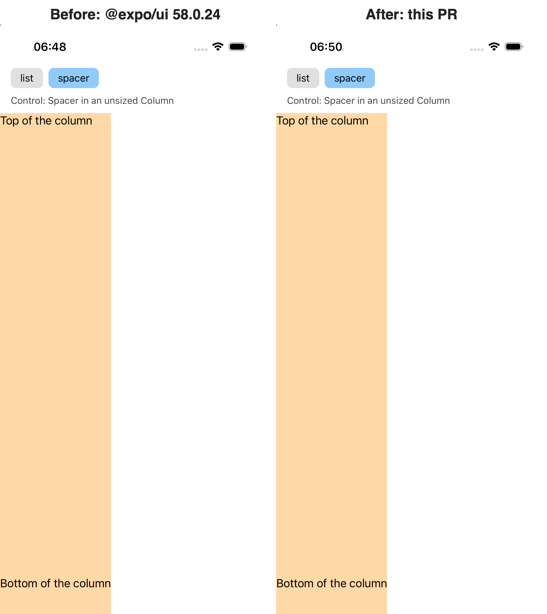

# expo-ui Column zero width repro

Reproduction and fix check for [expo/expo#52410](https://github.com/expo/expo/issues/52410):
on iOS, a universal `Column` from `@expo/ui` with no size of its own lays out at width 0
since `@expo/ui` 58.0.23, so a `List` inside it renders nothing.

## Before and after

Left: stock `@expo/ui` 58.0.24. Right: the same project with the fix from the PR,
`ExpoUI` built from source. iPhone 17 simulator, iOS 26.5, captured on 10/28/26.

The control case keeps a flexible `Spacer` from stretching an unsized `Column`,
which is the behaviour the old code protected. It is unchanged by the fix:

Recording of a cold start of each build, side by side. The screen switches between the two
cases every 5 s:

The same recording as an MP4: [media/before-after.mp4](media/before-after.mp4).
Single captures: [before.mp4](media/before.mp4), [after.mp4](media/after.mp4),
[before-list.png](media/before-list.png), [after-list.png](media/after-list.png),
[before-spacer.png](media/before-spacer.png), [after-spacer.png](media/after-spacer.png).
